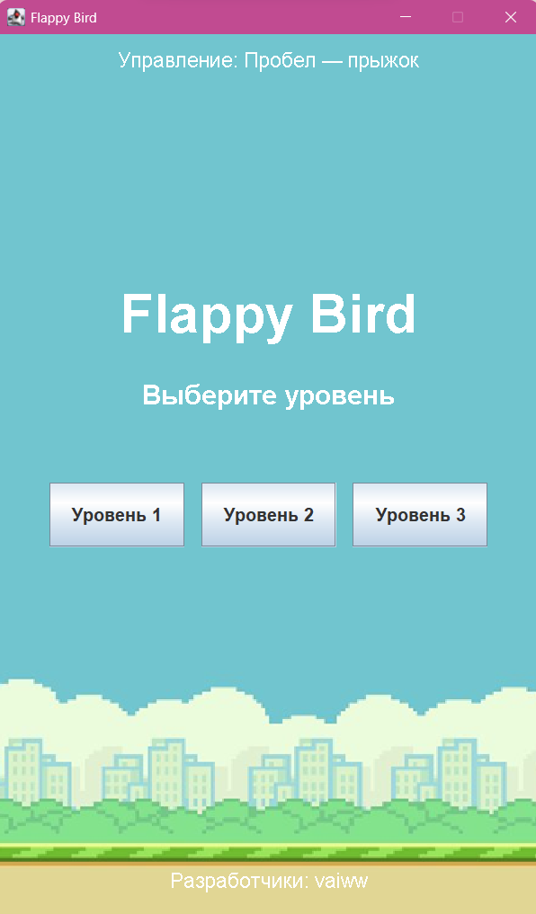
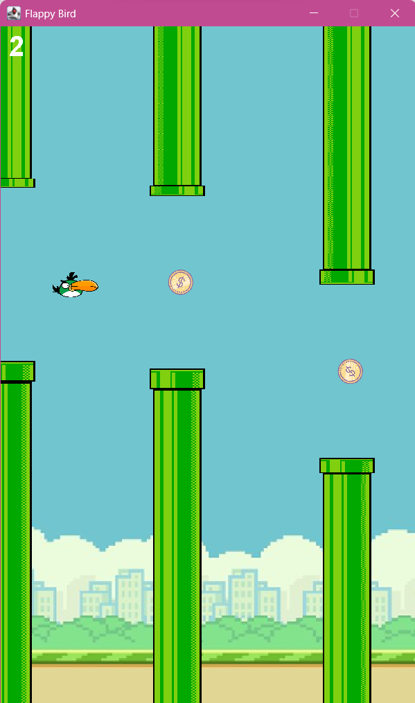
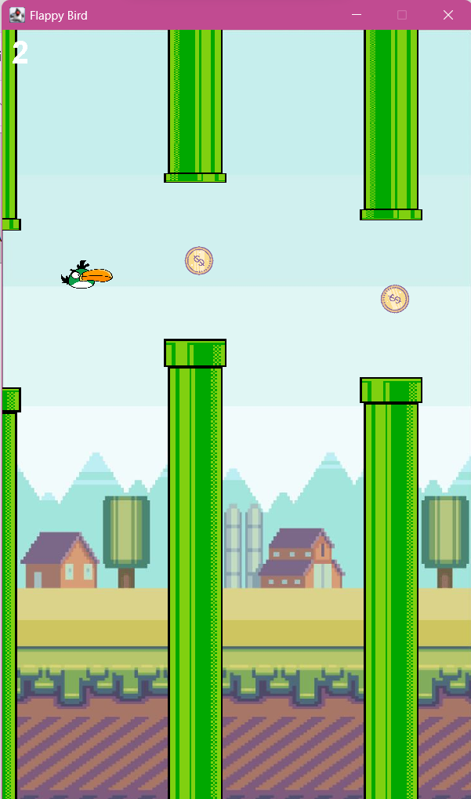
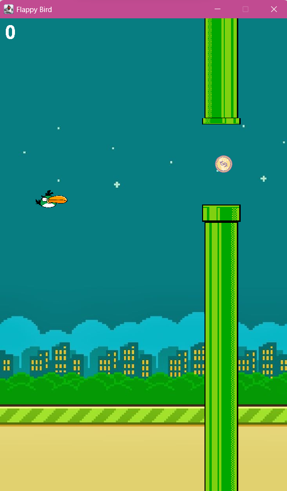
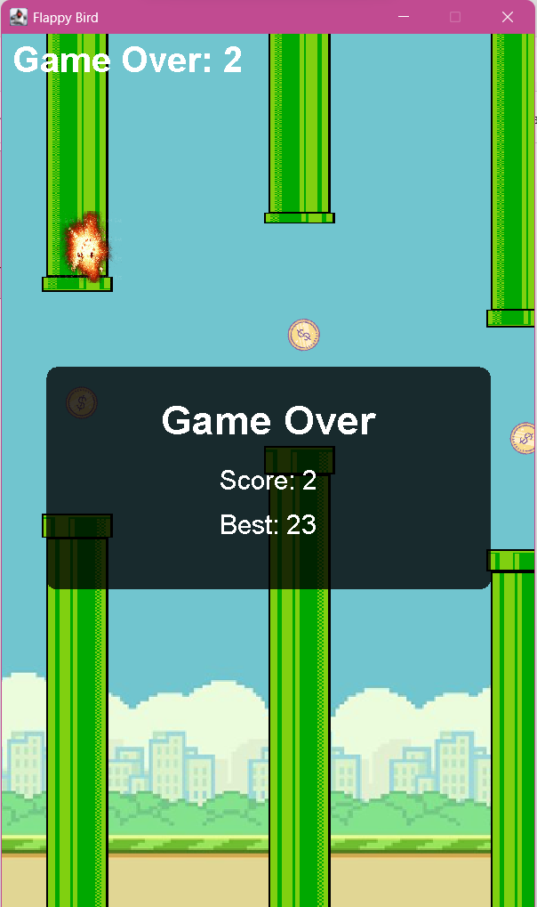

# Flappy Bird

A Java Swing arcade game inspired by the classic Flappy Bird. This is an educational project with an expanded level system, collectible coins, visual effects, and a locally saved high score.

## Screenshots

### Main menu


### Gameplay
| Level 1 | Level 2 |
| --- | --- |
|  |  |

### Level 3 and Game Over
| Level 3 | Game Over |
| --- | --- |
|  |  |

## Features

- Three difficulty levels with different pipe speeds, gaps, and spawn intervals.
- Automatic progression to the next level after reaching 15 points on the current level.
- Bird movement with gravity and keyboard controls.
- Randomly generated pipe obstacles and collision detection.
- Collectible coins that add to the score.
- Score for passing obstacles.
- Animated transitions between levels and an explosion effect on collision.
- Game Over screen with the current score and best score.
- Best score saved locally using Java Preferences.

## Controls

| Key | Action |
| --- | --- |
| `Space` | Make the bird flap upward |

## Requirements

- JDK 14 or newer.
- A Java IDE such as IntelliJ IDEA (optional).

The project uses Java Swing and AWT; no external Java libraries or build tools are required.

## How to Run

### From the command line

1. Clone or download this repository.
2. Open a terminal in the project root directory.
3. Compile the application:

   ```bash
   javac App.java FlappyBird.java
   ```

4. Run it:

   ```bash
   java App
   ```

Run the application with the project root as the classpath root so that the image and audio files can be loaded from the classpath.

### From an IDE

Open the project in your Java IDE and run the `main` method in `App.java`. Make sure the project root (the directory containing the asset files) is included in the runtime classpath.

## Project Structure

```text
.
├── App.java                 # Application entry point
├── FlappyBird.java          # Game logic, rendering, input, and timers
├── screenshots/             # Gameplay screenshots
├── resources/               # Additional resource files
├── flappybird.png           # Bird sprite
├── flappybirdbg.png         # Background
├── toppipe.png              # Upper pipe
├── bottompipe.png           # Lower pipe
├── nightbg.png              # Alternative background
├── forestbg.png             # Alternative background
├── coin.png                 # Collectible coin
├── explosion.png            # Collision effect
├── jump.wav                 # Jump sound
└── coin.wav                 # Coin collection sound
```

## Technologies

- Java
- Java Swing
- Java AWT
- Java Sound API
- Java Preferences API

## Credits and Asset Notes

This is an educational adaptation, not an original implementation of the Flappy Bird concept.

The initial version of the basic Flappy Bird mechanics and several of the original visual assets (bird, pipes, and background) are based on the Java tutorial and example project by [itsme-jd](https://github.com/itsme-jd/Flappy-bird-game-using-java). The repository links to the [coding tutorial on YouTube](https://youtu.be/jj5ADM2uywg).

Other images, backgrounds, and sound effects were collected from publicly available online sources. Unfortunately, the original source pages and individual authors were not recorded, so their provenance and licenses could not be reliably verified. They are listed here transparently rather than attributed to an unconfirmed author. Please contact the project owner if you are a rights holder and have questions about an asset.

The game code in this repository has been adapted and extended for this educational project.

---

Made by **vaiww**.
